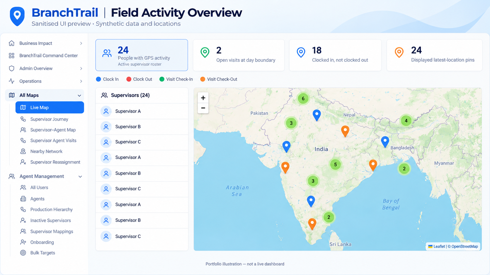
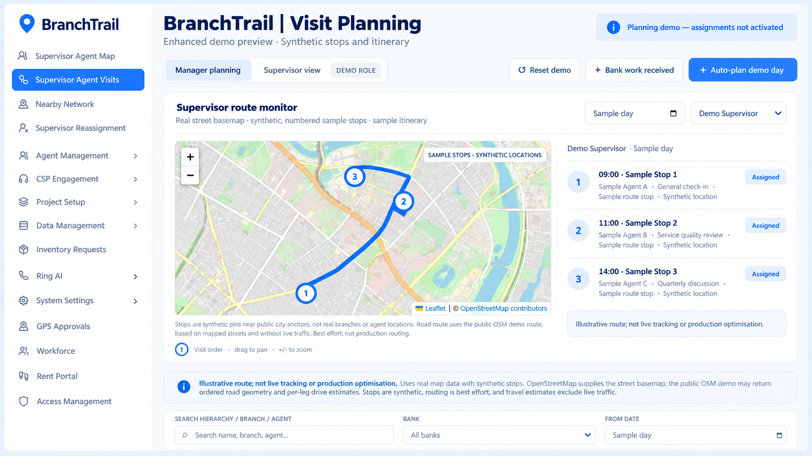

# BranchTrail — A Connected Field-Operations Ecosystem

### Selected product case study · Zaid Bin Shafi

**BranchTrail is a role-based field-operations ecosystem that connects field visibility with operational action:** understanding workforce ownership, recording branch visits and evidence, reviewing supervisor activity, organising agent visits, managing onboarding and engagement, and investigating performance through consistent reporting.

It is one flagship example within my wider product work at Manipal Business Solutions. A review of the main application shows a broader modular ecosystem than maps alone: field visits, agent administration, onboarding, engagement, AI campaigns, inventory, workforce and rent workflows. These are distinct modules with different users, access rules and release states—not one undifferentiated dashboard.

**My role:** AI Product Manager — product requirements, user journeys, release priorities, stakeholder alignment and measurement requirements.

[Portfolio](https://zaid-portfolio-3d.netlify.app/) · [GitHub](https://github.com/Zaidshafi) · [LinkedIn](https://www.linkedin.com/in/zaidshafi/)

> **About this showcase:** This is a sanitised product narrative, not a production access point or source-code release. Recreated visuals are illustrative and use synthetic data. Production readiness varies by module. Demo planning is not live automatic assignment. No company source code, credentials, employee records or actual field locations belong in this repository.

## 1. The problem: seeing activity is not the same as managing it

Financial-inclusion field operations involve several connected questions:

- Who owns each agent relationship, and which supervisor or manager should act?
- Where is field activity taking place, and what does a recorded event actually mean?
- Which agents have been visited, which visits are complete, and where is follow-up needed?
- How should agent visits fit around bank-related responsibilities?
- Can a manager move from a headline KPI to the records behind it?
- Are different reporting views using the same ownership rules and time window?

When these questions are answered in disconnected views, teams can spend time reconciling numbers or locating the right owner before taking action. A map alone cannot resolve that problem. It needs hierarchy, meaningful event definitions, visit context and inspectable records.

**The product objective:** create a connected operating picture in which visibility, ownership and the next action are understandable to the people responsible for execution.

## 2. Who the product serves

| User group | Main question | Product need |
| --- | --- | --- |
| Management and operations | Where should we focus attention? | Consolidated activity views, bank/project segmentation and drill-downs |
| State heads and regional managers | What is happening within my responsibility? | Hierarchy-aware filtering and consistent ownership rules |
| Supervisors | What needs my attention in the field? | Agent context, visit workflows and journey visibility |
| Administrators | Who should see or change what? | Role-based access, valid mappings and controlled activation |

Agents are central to the workflows being managed; that does not imply that every agent has a dedicated user-facing BranchTrail screen.

## 3. The ecosystem: how the pieces relate

### Product map

| Product area | Purpose | What the application structure establishes |
| --- | --- | --- |
| Branch visit execution | Capture the field workflow from branch selection through completion | Check-in, questionnaire, check-out, visit history and detail experiences |
| Field intelligence | Explain recorded activity and geography | Activity map, supervisor journeys, supervisor–agent mapping and nearby-network views |
| Agent and hierarchy administration | Keep operational ownership understandable | Agent management, hierarchy and mapping workspaces |
| Onboarding and engagement | Turn referrals and interactions into follow-up work | Onboarding stages, referral-outcome views and an engagement desk |
| AI campaign operations | Organise automated outreach and review outcomes | Campaign creation, queues, scripts, call history and analytics surfaces |
| Operational support | Support the wider field network | Inventory requests, workforce management and rent workflows |
| Governance | Control access and make actions traceable | Role-based views, module access, approvals and audit experiences |

**Evidence boundary:** this map is based on the main application's README, route structure and selected page implementations, together with user-supplied screenshots. The existence of a route establishes application scope; it does not establish that every feature is enabled, production-validated or accessible to every role. Private code and internal implementation details are not reproduced here.

### The core field workflow

The supervisor experience includes branch selection, check-in, a questionnaire, check-out and a completion view, supported by visit history and visit details. The repository documentation also identifies evidence capture, geofencing and compliance tracking as part of the product's field-operations remit.

This matters because a field visit is more than a pin on a map. It has an intended location, a sequence of actions, information captured during the visit and a completion record. Management needs to inspect that context while the supervisor needs a usable execution flow.

**Illustrative end-to-end journey:** a supervisor identifies the relevant branch, records a visit and its questionnaire/evidence, completes the visit, and management reviews the associated history and reporting. This describes the product flow; it does not claim an observed production visit or disclose an agent's actual movements.

### A. Workforce ownership and hierarchy

Hierarchy provides the context for field decisions. State-head, regional-manager and supervisor relationships should determine the relevant records and eligible users.

A key requirement is handling cross-state responsibility. If one head owns more than one state, filtering should reflect that ownership rather than silently excluding users based only on geography.

**Product decisions:** dependent filters; searchable, multi-select controls; consistent mapping rules; validation around ownership changes.

### B. Field activity and map visibility

The supplied map screen brings an activity summary, supervisor list, map pins/clusters and event legend together. Event types include clock-in, clock-out, visit check-in and visit check-out.

An important distinction is between a person's latest recorded location, a historical activity window and continuously live tracking. A portfolio preview must not imply that a historical screenshot is a current stream of locations.

**Product decisions:** keep activity definitions visible; connect KPI selection to the map and list; show the relevant time context; avoid treating GPS presence as proof of a completed or productive visit.

### C. Supervisor journeys and agent visits

Journey visibility and visit execution answer different questions. The first helps explain movement and recorded activity. The second needs visit ownership, purpose, status and completion context.

The visit-planning demo supplied for this case study displays a route monitor, numbered sample stops, an itinerary, and separate manager-planning and supervisor views.

**Product decisions:** account for territory, due priority and supervisor availability; consider agent visits alongside bank responsibilities; separate planning from the authority to activate assignments.

> **Status boundary:** automatic planning is shown as a controlled demo. It is not evidence that live automatic assignments or production route optimisation have been activated. The supplied demo uses synthetic sample stops and a public map/routing service; route estimates exclude live traffic.

### D. Management reporting and drill-downs

Reporting should let a manager understand both the number and its meaning. Requirements include a shared date window, bank/project filters, short KPI definitions, clickable detail views and exports.

For example, visit events, completed visits and unique agents visited are different measures. They should not be combined or described as interchangeable.

**Product decisions:** traceable KPI definitions; explicit reporting periods; consistent filter behaviour; detailed records behind totals; investigation of discrepancies rather than cosmetic reconciliation.

### E. Adjacent onboarding and campaign workflows

My wider Manipal work spans AI-assisted onboarding, WhatsApp/IVR/AI calling, campaign launch workflows and analytics. These workflows complement field operations by helping teams understand engagement and follow-up requirements.

Examples of product scope include a one-click resumable campaign launch, auditable funnel drill-downs and a 48-hour post-WhatsApp measurement window.

The main application contains separate onboarding, engagement and AI campaign surfaces. In the onboarding outcome view, referral leads can be summarised by supervisor and explored through Interested, Not interested and Callback outcomes. The engagement workspace models contact status, interaction tags, issue/resolution details and follow-up timing. This provides a clearer product story: an outreach outcome can inform the next operational action rather than ending as an isolated call statistic.

These are presented as **connected but distinct product areas**, not as a claim that every capability is part of the same BranchTrail screen or that measured contactability establishes a causal business uplift. The full referral-to-engagement handoff and live campaign operation were not revalidated during this portfolio review.

### F. Adjacent asset and inventory workflows

My product scope also includes asset lifecycle requirements such as serialized devices, procurement/receipt, reconciliation, field custody, returns and audit views. This is another example of connecting ownership with an operational lifecycle.

This showcase does not reproduce private inventory records or imply that the inventory workflow is the central BranchTrail map experience.

## 4. My ownership

My role connects operational needs to an implementable, measurable product scope:

1. **Define the problem and user journey:** translate field and management questions into requirements with clear owners and expected actions.
2. **Prioritise delivery:** align operations and engineering on release priorities, dependencies and acceptance criteria.
3. **Define behaviour:** specify hierarchy-dependent filters, role-based views, KPI definitions, drill-downs and export expectations.
4. **Support acceptance:** review reported discrepancies and workflow issues against intended behaviour, and feed them into release priorities.
5. **Define measurement:** make the reporting period, metric population and underlying records understandable.

This is product ownership; it is not a claim that I personally authored every line of code, independently delivered every module, or solely produced every business result.

### Technical context

The application uses React and TypeScript with Vite, Tailwind CSS and shadcn/ui. Supabase supports the data, authentication, storage and server-function layers; Vitest and Testing Library support automated checks. This technical context explains the delivery environment, not a claim of sole engineering authorship or an independent security assessment.

## 5. Decisions and trade-offs

| Decision | Why it matters | Trade-off or guardrail |
| --- | --- | --- |
| Filter by responsibility, not geography alone | Cross-state ownership must remain usable | Mapping rules require validation and consistent application |
| Link KPIs to records | Managers need to investigate, not just observe | Drill-down totals and definitions must reconcile |
| Make the date window explicit | Historical activity can otherwise be mistaken for current state | All dependent views must respect the intended period |
| Separate management and supervisor experiences | Oversight and field execution have different needs | Role permissions must remain consistent |
| Keep planning distinct from assignment activation | A good preview should not silently create field obligations | Demo and live states require clear labels and controls |
| Consider bank duties alongside agent visits | Supervisor time cannot be allocated in isolation | Planning needs realistic availability inputs |
| Show synthetic locations in a public case study | Demonstrates spatial workflows without disclosing personnel movements | Synthetic previews must never be presented as live evidence |

## 6. Measurement framework

The following distinguishes visible concepts and reporting requirements from suggested evaluation measures. It is not a list of verified business improvements.

| Area | Measures / questions | Evidence status |
| --- | --- | --- |
| Activity visibility | People with GPS activity, clock-in/out state, displayed location pins | Concepts visible in supplied map screenshot; real values withheld |
| Visit execution | Visits, completed visits, unique agents visited within a date window | Product reporting requirements |
| Ownership integrity | Are eligible users included under the correct hierarchy? | Acceptance question; no public error-rate claim |
| Reporting integrity | Do top-level totals reconcile with detailed records? | Acceptance question; no public improvement percentage |
| Planning usefulness | Can users understand stop order, purpose and estimated travel? | Demo evaluation question; not validated production efficiency |
| Operational adoption | Are intended users using the relevant workflows consistently? | Proposed evaluation dimension; no adoption figure claimed |

**No quantified BranchTrail ROI, revenue, retention or productivity uplift is claimed here.** A defensible impact statement would require a defined baseline, reporting period, population and measured result.

## 7. Visual showcase

Two enhanced previews were recreated from supplied screenshots using AI image editing. They are not pixel-faithful production captures: labels, map details and layouts may differ. They illustrate workflows, not authoritative cartography or measured operational results.

1. **Field Activity Overview:** map/list interaction and activity KPIs, recreated with fictional people, counts and locations.
2. **Visit Planning Demo:** route monitor and sample itinerary, preserving the distinction between a demo plan and activated assignments.

### Field Activity Overview

*AI-recreated UI illustration. All people, counts and marker positions are synthetic. Cluster counts and visible map markers are illustrative rather than a reconciled dataset.*

### Visit Planning Demo

*AI-recreated demo illustration. Synthetic stops and itinerary; assignments are not activated. Not a production routing or live-tracking claim.*

Original production screenshots containing people and location records are deliberately excluded. Recreated images should be captioned as enhanced illustrative previews, not actual production screenshots.

## 8. What this case study demonstrates

- Systems thinking across users, hierarchy, field execution and measurement.
- Translating operational complexity into understandable product requirements.
- Balancing usability with permissions, data quality and activation controls.
- Connecting dashboards to decisions rather than treating reporting as the end goal.
- Clear boundaries between delivered behaviour, requirements, demos and hypotheses.

For a consumer-growth role, this work demonstrates product execution and measurement discipline. My consumer experimentation and analytics experience at Magicpin and Zomato is complementary evidence; BranchTrail itself is not presented as a subscription, paywall or in-app-purchase product.

## 9. Repository boundary

**Included:** a sanitised product narrative and clearly labelled synthetic previews.

**Excluded:** company source code; credentials; production endpoints; employee/agent identifiers; private contact details; real movement trails; internal exports; and unsupported business-impact claims.

BranchTrail is discussed in the context of my work at Manipal Business Solutions. This portfolio case study does not imply company endorsement, ownership transfer or permission to reuse company code or data.

---

**Zaid Bin Shafi** · Product, analytics and AI workflows  
[Explore my portfolio](https://zaid-portfolio-3d.netlify.app/) · [View my GitHub profile](https://github.com/Zaidshafi)
